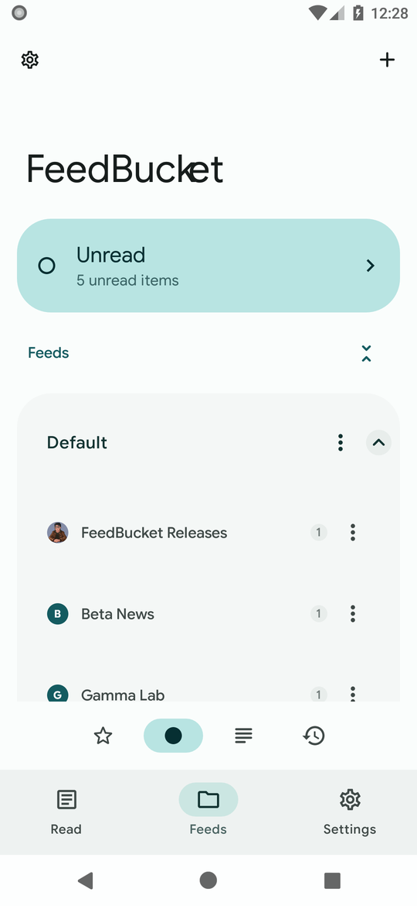
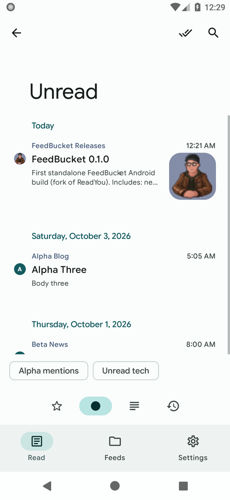
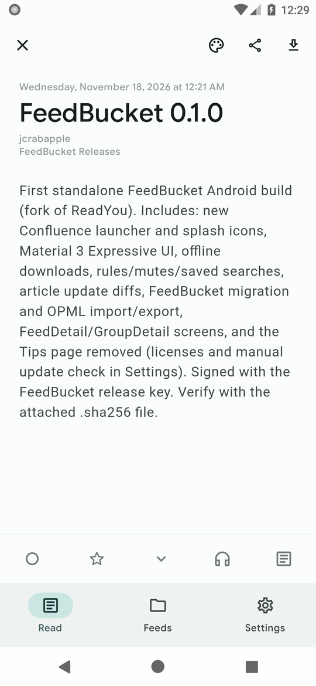
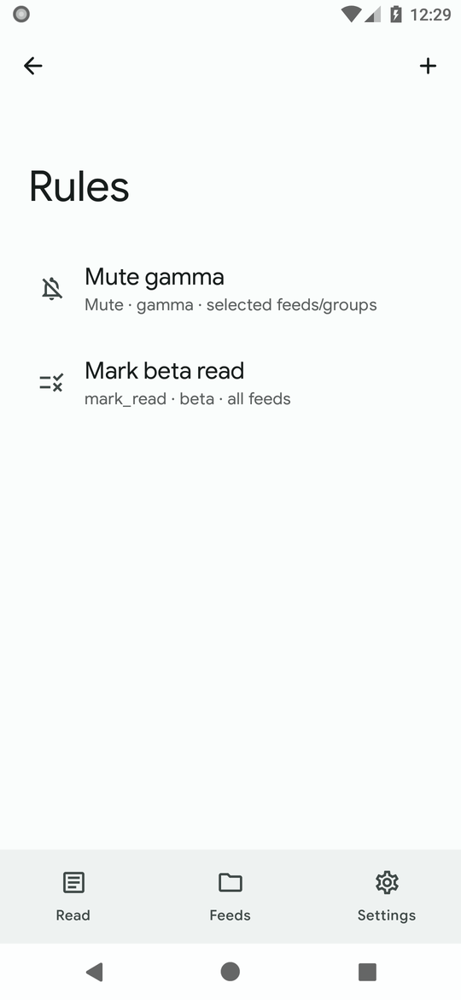
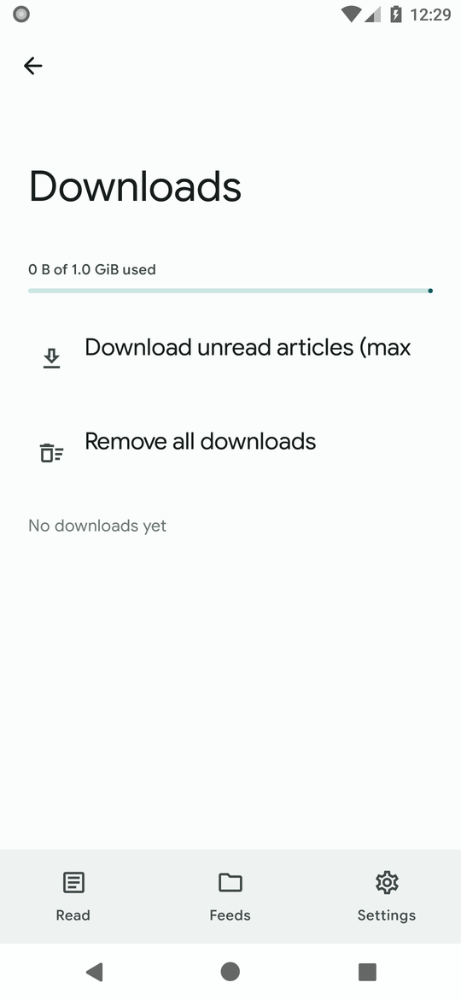

<div align="center">
    
    <h1>FeedBucket</h1>
    <p>A standalone, local-first Android RSS reader. No account, no server, no sync.</p>
    
    <a target="_blank" href="https://github.com/jcrabapple/feedbucket-android/releases">
        
    </a>
</div>

<p align="center">
    
    
    
    
    
</p>

FeedBucket is a fork of **[Read You](https://github.com/ReadYouApp/ReadYou)**, an Android RSS reader by **Ash** (ReadYouApp). It keeps Read You's Kotlin and Jetpack Compose foundation and changes what the app is for: a single-device reader that works offline, keeps its own state reliably, and imports your existing FeedBucket web data. It is pre-1.0 and built for personal use first.

## Credit

FeedBucket would not exist without **Read You** and its developer, **Ash** ([ReadYouApp/ReadYou](https://github.com/ReadYouApp/ReadYou), [ash7.io](https://ash7.io)). Read You is licensed GPL-3.0, and so is FeedBucket. Upstream copyright and license notices are kept in the source and in [LICENSE](LICENSE).

FeedBucket is not affiliated with or endorsed by the Read You project. If you use Read You, support its developer through the upstream project. The sponsorship links were removed from this fork.

The rest of the upstream credits, including MusicYou (design inspiration and the Monet engine by Kyant0), JetBrains, Weblate, and the open-source libraries Read You builds on, are listed at the end of this file.

## What FeedBucket does

- **Subscriptions and feeds:** add RSS and Atom feeds, group them, and import or export OPML. Inherited from Read You.
- **Read state you can trust:** read and unread state persists across restarts. Reading positions are restored when you return to a feed. There is a recently-read list with next and previous navigation.
- **Offline reading:** download articles with their text and images, stored on the device. Limits: 2 MiB of text and up to 10 MiB of images per article, 1 GiB total. Offline articles render in a locked-down WebView with JavaScript off and no outside requests.
- **Offline search:** full-text search across cached articles. Each account shows how much of its content is indexed.
- **Rules, mutes, and saved searches:** rules mark matching items read or starred. Mutes hide matches. Each change shows a preview first, can be applied to existing articles, and is recorded in an apply ledger that you can undo.
- **Updated articles:** when a publisher edits a post, FeedBucket flags it, keeps the first version, and shows a word-level diff. You can turn update tracking off per feed.
- **Migration from FeedBucket web:** import a FeedBucket v1 export package (or a raw database copy) through a preview that shows counts before anything is written. Imports run on the device, check for secrets before writing, and can be removed cleanly afterward.
- **Provider support inherited from Read You:** Fever and the Google Reader protocol (FreshRSS and compatible servers). These have not been re-tested in FeedBucket.

## What FeedBucket changes from Read You

**Added**

- Offline downloads with size caps, a storage page, and offline full-text search.
- Read-state and reading-position reliability.
- Rules, mutes, saved searches, and the apply ledger.
- Article update detection and word-level diffs.
- The FeedBucket migration importer, and OPML import with duplicate handling and counts.
- Material 3 Expressive UI with a static petrol and ink palette, reduced-motion support, and 48dp touch targets. Dynamic color is an opt-in and is off by default.
- `FeedDetail` and `GroupDetail` screens.

**Removed**

- The Tips & Support page and its sponsor dialog. The licenses screen and the manual update check are now in Settings.
- Upstream's release-signing keystores. FeedBucket's release key is kept outside the repository.
- Read You's update channel. The app checks only FeedBucket releases (see below).

**Not implemented**

- Feedly and Inoreader are placeholders in Read You too, and they are not implemented here.
- Miniflux, Tiny Tiny RSS, and Feedbin are not implemented here.

## Updates

FeedBucket checks GitHub for releases tagged `feedbucket-vX.Y.Z` on this repository. It accepts only a `FeedBucket-X.Y.Z.apk` asset with a matching `.sha256` file. It verifies the SHA-256 hash before handing the APK to the installer, and it never checks for updates in debug builds.

Releases are signed with FeedBucket's release key. An APK signed with a different key will not install over an existing one.

## Install

Download the APK from the [latest release](https://github.com/jcrabapple/feedbucket-android/releases/latest) and check it against its `.sha256` file:

```shell
sha256sum -c FeedBucket-0.1.0.apk.sha256
```

Application IDs: `us.snakepit.feedbucket` (release) and `us.snakepit.feedbucket.debug` (debug, installs side by side).

## Build

Clone the repo and open it in Android Studio, or build from the command line:

```shell
git clone https://github.com/jcrabapple/feedbucket-android.git
cd feedbucket-android
./gradlew :app:assembleGithubDebug
```

Release builds need a private keystore. Point `FEEDBUCKET_KEYSTORE_PROPERTIES` at a `keystore.properties` file outside the repo, or place one at the repo root (gitignored). Without it, release tasks fail on purpose, so an unsigned release is never produced by accident.

Development branch: `feedbucket-native`.

## Status and limits

- Pre-1.0. CI runs the instrumented suite on API 35 and API 36 emulators. Manual testing has been on an API 26 emulator and one physical phone (Galaxy S26). Other devices are untested.
- Not on Google Play or F-Droid.
- New FeedBucket strings are English-only. Read You's translations of its own strings still ship, and some are out of date.
- The translated READMEs in this repository (`README-*.md`) describe upstream Read You, not FeedBucket.

## License

GNU GPL v3.0. Copyright notices for Read You are retained, and FeedBucket's changes are under the same license. See [LICENSE](LICENSE).

The bundled Google Sans Flex font is licensed under the SIL Open Font License 1.1 (see `app/src/main/res/raw/ofl_google_sans_flex.txt`).

## Credits

### Upstream

- [Read You](https://github.com/ReadYouApp/ReadYou) by Ash (ReadYouApp), the upstream project this fork is based on.
- Thanks to **@Kyant0** for the design inspiration and the Monet engine. See [MusicYou](https://github.com/Kyant0/MusicYou).
- Thanks to **JetBrains** for free open-source IDE licenses, and to **Weblate** for hosting Read You's translations.

### Open source projects

- [MusicYou](https://github.com/Kyant0/MusicYou)
- [ParseRSS](https://github.com/muhrifqii/ParseRSS)
- [Readability4J](https://github.com/dankito/Readability4J)
- [opml-parser](https://github.com/mdewilde/opml-parser)
- [compose-html](https://github.com/ireward/compose-html)
- [Rome](https://github.com/rometools/rome)
- [Feeder](https://gitlab.com/spacecowboy/Feeder)
- [Seal](https://github.com/JunkFood02/Seal)
- [news-flash](https://gitlab.com/news-flash)
- [besticon](https://github.com/mat/besticon)
- [Jiffy Reader](https://github.com/ansh/jiffyreader.com)
- ...
